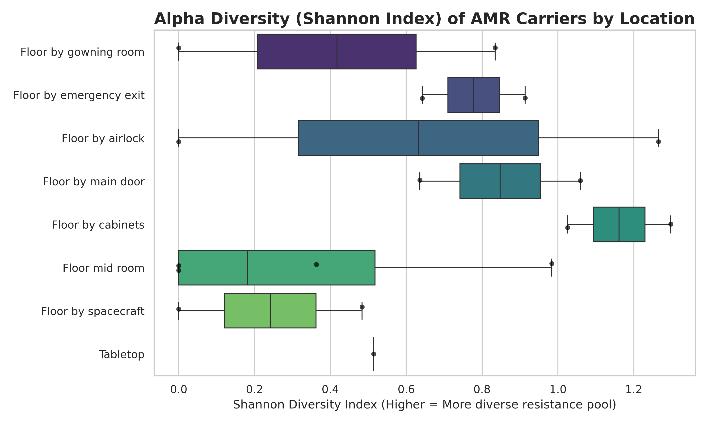
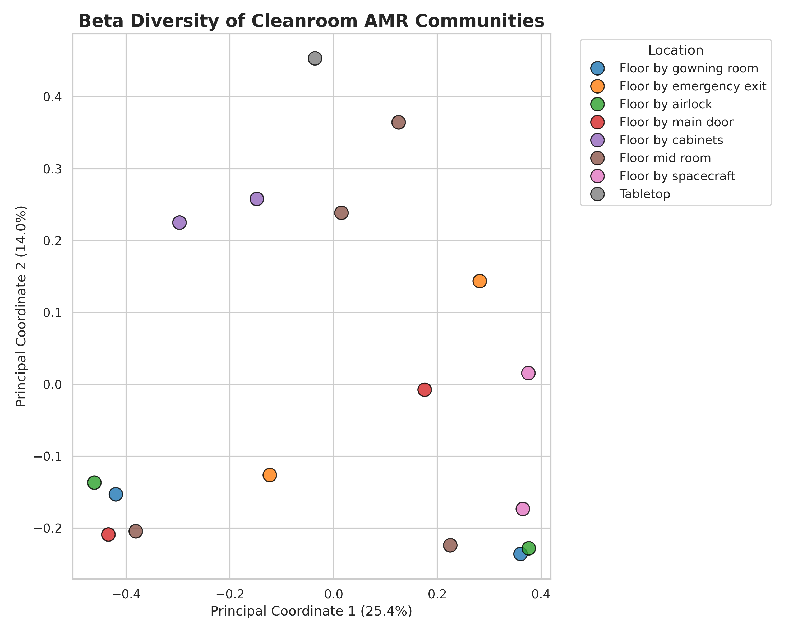
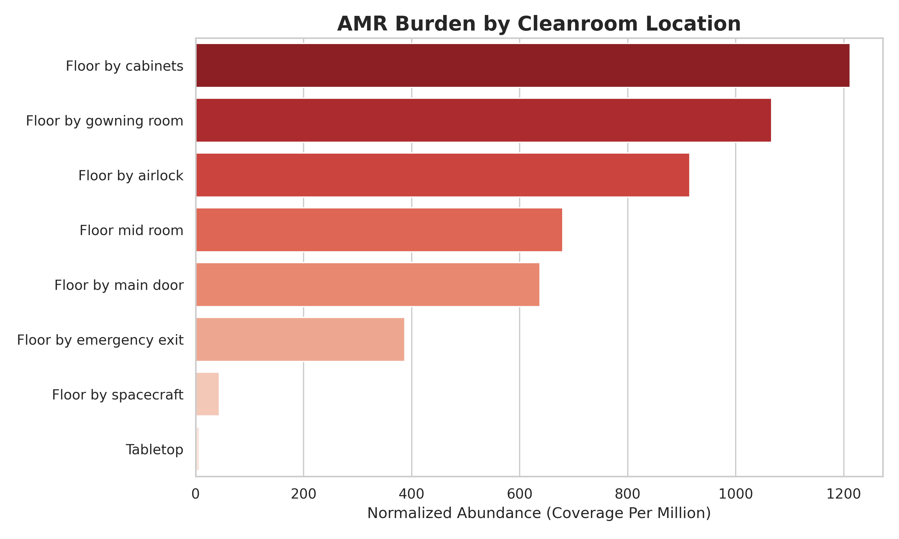
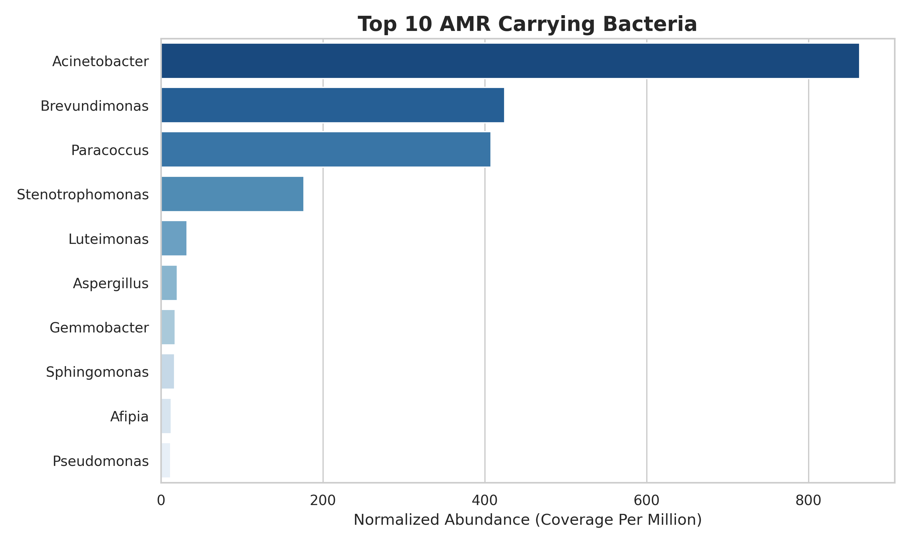
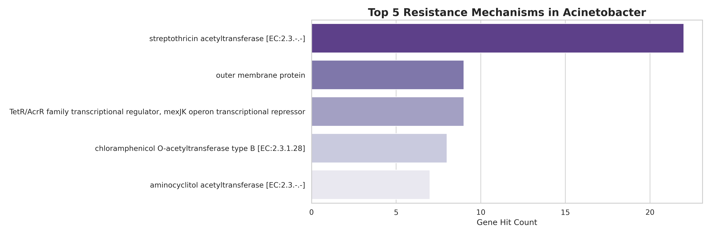

# Spacecraft Cleanroom Resistome Dynamics 🚀🦠
### *Environmental Resistome and Homogenization of Extremotolerant Communities in Jet Propulsion Laboratory Cleanroom Environments*

[](https://osdr.nasa.gov/bio/repo/data/studies/OSD-944)
[](https://doi.org/10.26030/3zww-vy60)
[](https://www.python.org/)
[](https://pandas.pydata.org/)
[](https://scipy.org/)
[](http://scikit-bio.org/)
[](https://creativecommons.org/publicdomain/zero/1.0/)

**Author(s):** Md Abu Sadat Soash  
*Department of Genetic Engineering and Biotechnology*<br>
*Shahjalal University of Science and Technology, Sylhet, Bangladesh*

---

## 📌 Abstract

Jet Propulsion Laboratory (JPL) cleanroom environments adhere to strict planetary protection protocols to minimize microbial bioburden, inadvertently creating selective pressures that drive the survival of extremotolerant, multidrug-resistant (MDR) microbes. This study maps the spatial distribution and ecological diversity of the environmental resistome within a JPL Mars Exploration Program cleanroom using short-read metagenomic sequencing data (**OSD-944** / **GLDS-775**). Following the removal of mock community controls and normalization of sequencing depth to Coverage Per Million (CPM), the resistome was characterized against the KEGG and BacMet databases.

Spatial analysis revealed the highest localized burdens of antimicrobial resistance (AMR) in human transition zones, specifically the floor by cabinets (1,211.6 CPM) and gowning rooms (1,066.5 CPM), while critical spacecraft assembly surfaces exhibited near-zero AMR loads. Despite these observational differences, statistical evaluations including Kruskal-Wallis ($H = 8.5686, p = 0.285$) and PERMANOVA (pseudo-$F = 1.123, p = 0.321$) indicated no significant spatial variance in total AMR burden or microbial community composition across the facility footprint. Taxonomic profiling identified primary carriers of resistance mechanisms as *Acinetobacter*, *Brevundimonas*, and *Paracoccus* species, alongside eukaryotic fungi such as *Aspergillus*. The detection of broad-spectrum efflux pumps, such as *mexJK*, and dual-resistance genes highlights a uniform, highly selected microbiome shaped by stringent sterilization protocols.

---

## 🧬 Key Scientific Findings

### 1. Assembly Success & Master Functional Matrix
From 38 raw samples, 32 samples processed under the standardized "Prep 3" Illumina Nextera XT protocol were curated. Environmental cleanroom samples demonstrated a 100% assembly rate, yielding a unified matrix of 62,195 functional gene annotations.

| Metric | Environmental Samples | Control Samples | Total Dataset |
| :--- | :---: | :---: | :---: |
| **Targeted Samples (Prep 3)** | 18 | 14 | 32 |
| **Failed Assembly** | 0 | 7 | 7 |
| **Successfully Assembled** | 18 | 7 | 25 |
| **Assembly Success Rate** | **100%** | 50.0% | **78.1%** |
| **Total Functional Genes (ORFs)** | 56,282 | 5,913 | 62,195 |
| **AMR Genes Detected (KEGG)** | 447 | 62 | 509 |
| **Dual-Resistance Genes (AMR + BRG)** | **64** | 0 | **64** |

### 2. The Cleanroom Resistome & Dual-Resistance Determinants
* **Total ARGs & BRGs:** 509 Antimicrobial Resistance Genes (KEGG `ko01504`) and 904 Biocide/Metal Resistance Genes (BacMet) were mapped across the dataset. Isolating the cleanroom samples confirmed 447 bona fide environmental ARGs across 13 bacterial genera.
* **Dual Resistance (Cross-Resistance):** 64 genes confer simultaneous resistance to both biocides/metals and clinical antibiotics (e.g., *merR* family [K19591], *tetR*/*acrR* family transcriptional repressors [K18301], and *mexJK* broad-spectrum efflux systems). All 64 dual-resistance genes were localized exclusively within environmental samples.
* **Primary Microbial Reservoirs:**
  * ***Acinetobacter* (863.1 CPM):** Mediated predominantly by streptothricin acetyltransferases and TetR/AcrR family repressors.
  * ***Brevundimonas* (424.5 CPM):** Enriched in fluoroquinolone resistance proteins, BlaI family penicillinase repressors, and PhoQ sensor histidine kinases.
  * ***Paracoccus* (407.8 CPM):** Characterized by aminocyclitol acetyltransferases and multidrug efflux pumps.
  * ***Aspergillus* (20.1 CPM):** Eukaryotic fungal lineage carrying resistance factors (preliminary detection via prokaryotic ORF calling).

### 3. Spatial Distribution & Facility Homogenization
* **Localized Burdens:** Human transition zones demonstrated the highest AMR densities:
  * Floor by cabinets: **1,211.6 CPM**
  * Gowning room floor: **1,066.5 CPM**
  * Airlock floor: **914.8 CPM**
  * Mid-room floor: **679.6 CPM**
  * Main door floor: **637.6 CPM**
  * Emergency exit floor: **387.4 CPM**
  * Spacecraft hardware assembly surfaces: **43.8 CPM (near-zero)**
  * Tabletop surfaces: **7.4 CPM**
* **Statistical Homogeneity:**
  * **Kruskal-Wallis $H$-test:** $H = 8.5686, p = 0.285$ (no significant spatial difference in total AMR burden).
  * **PERMANOVA (Beta Diversity, 8 locations):** pseudo-$F = 1.123, p = 0.321$ (no significant divergence in microbial community structure).
  * **Conclusion:** Cleanroom decontamination regimens act as an overarching selective filter that homogenizes the resident extremotolerant community across the entire facility footprint.

---

## 📈 Key Visualizations

### Ecological Diversity of the Resistome
| Alpha Diversity (Shannon Index Across Locations) | Beta Diversity (Principal Coordinate Analysis - True PCoA) |
| :---: | :---: |
|  |  |

### Taxonomic & Spatial Resistance Burden
| Total AMR Load by Cleanroom Physical Location | Top 10 AMR-Carrying Bacterial Genera |
| :---: | :---: |
|  |  |

### Resistance Mechanisms in Dominant Extremophiles
**Top 5 Resistance Mechanisms driving the extremophile *Acinetobacter*:**
<br>


---

## ⚙️ Pipeline Architecture

The workflow is available in two parallel formats: **automated CLI scripts** (`run.py` & `.py`) for production execution, and **interactive Jupyter Notebooks** (`.ipynb`) for step-by-step exploration.

```text
NASA OSDR OSD-944 ISA Metadata & S3 Annotations
                         │
                         ▼
             1_clean_metadata (.py / .ipynb)
             └── Filter Prep 3 swabs vs. controls (Sample_Category)
                         │
                         ▼
             2_clean_assaydata (.py / .ipynb)
             └── Standardize read depths, QA/QC metrics, & concentrations
                         │
                         ▼
             3_download_annotations (.py / .ipynb)
             └── Asynchronously fetch gene-coverage tables from AWS S3
                         │
                         ▼
             4_build_master_matrix (.py / .ipynb)
             └── Assemble 62,195 ORFs and compute Coverage Per Million (CPM)
                         │
                         ▼
             5_resistome (.py / .ipynb)
             └── Cross-reference KEGG AMR & BacMet BRGs; detect dual resistance
                         │
                         ▼
             6_stat (.py / .ipynb)
             └── Compute Alpha/Beta diversity, Kruskal-Wallis, & PERMANOVA
```

### Pipeline Steps Overview

1. **`1_clean_metadata`**: Parses raw ISA-Tab archives (`s_OSD-944.txt`, `i_Investigation.txt`). Filters for short-read low-biomass Illumina sequencing (`Prep 3`) and distinguishes environmental cleanroom swabs from controls (`Sample_Category`). Outputs `data/clean_metadata.tsv`.
2. **`2_clean_assaydata`**: Extracts sequencing metrics including raw read counts, post-filtering depth, DNA concentration, and decontamination rates. Outputs `data/clean_assaydata.tsv`.
3. **`3_download_annotations`**: Automated batch downloader fetching `gene-coverage-annotation-and-tax.tsv` files directly from NASA OSDR AWS S3 buckets for all target samples into `data/annotations/`.
4. **`4_build_master_matrix`**: Consolidates 25 individual assembly tables, applies Coverage Per Million (CPM) normalization relative to sample sequencing depths, and builds `data/master_functional_matrix.tsv`.
5. **`5_resistome`**: Cross-references functional genes against the KEGG Antimicrobial Resistance database (`ko01504`) and BacMet database. Identifies antibiotic classes, biocide/metal resistance, and 64 dual-resistance determinants. Exports `data/env_amr_df.tsv`, summary TSVs, and Figures 1–3.
6. **`6_stat`**: Computes Alpha diversity (Shannon index) and Beta diversity (Bray-Curtis dissimilarity, PCoA). Runs non-parametric Kruskal-Wallis and PERMANOVA tests across 8 cleanroom spatial locations. Generates Figures 4–5.

---

## 🚀 Execution & Usage

You can run the analysis either with the **one-click automated orchestrator** or interactively through **Jupyter Notebooks**.

### Method A: One-Click Automated Execution (Recommended)

The orchestrator script (`run.py`) automatically verifies dependencies, sets up an isolated environment if needed, and executes the entire pipeline sequentially with error handling and logging:

```bash
# Clone the repository
git clone https://github.com/Soash/nasa-osd944-resistome-analysis.git
cd nasa-osd944-resistome-analysis

# Run the complete end-to-end pipeline (Python 3.10+)
python run.py
```

### Method B: Interactive Jupyter Notebook Execution

If you wish to inspect and modify intermediate dataframes interactively:

```bash
# 1. Create and activate a virtual environment
python -m venv venv

# Windows (PowerShell):
.\venv\Scripts\Activate.ps1

# Linux / macOS:
source venv/bin/activate

# 2. Install dependencies
pip install -r requirements.txt  # or: pip install pandas requests matplotlib seaborn scipy scikit-bio

# 3. Launch Jupyter
jupyter notebook
```

Execute notebooks sequentially from `1_clean_metadata.ipynb` through `6_stat.ipynb`.

---

## 📂 Repository Structure

```text
.
├── run.py                                     # Master automated CLI pipeline orchestrator
├── 1_clean_metadata.py                        # CLI Step 1: Metadata curation & sample classification
├── 2_clean_assaydata.py                       # CLI Step 2: Sequencing metrics & read depths
├── 3_download_annotations.py                  # CLI Step 3: Automated S3 download of OSDR tables
├── 4_build_master_matrix.py                   # CLI Step 4: Consolidated CPM-normalized matrix
├── 5_resistome.py                             # CLI Step 5: KEGG/BacMet resistome profiling
├── 6_stat.py                                  # CLI Step 6: Ecological diversity & hypothesis testing
├── 1_clean_metadata.ipynb                     # Interactive Notebook 1
├── 2_clean_assaydata.ipynb                    # Interactive Notebook 2
├── 3_download_annotations.ipynb                # Interactive Notebook 3
├── 4_build_master_matrix.ipynb                # Interactive Notebook 4
├── 5_resistome.ipynb                          # Interactive Notebook 5
├── 6_stat.ipynb                               # Interactive Notebook 6
├── data/
│   ├── clean_metadata.tsv                     # Standardized sample metadata with Sample_Category
│   ├── clean_assaydata.tsv                    # Standardized sequencing quality & depth metrics
│   ├── master_functional_matrix.tsv           # CPM-normalized 62,195 functional gene matrix
│   ├── env_amr_df.tsv                         # Filtered cleanroom environmental resistome table
│   ├── summary_location_burden.tsv            # Total AMR burden (CPM) per cleanroom zone
│   ├── summary_genera_burden.tsv              # Total AMR burden (CPM) per microbial genus
│   ├── summary_acinetobacter_mechanisms.tsv   # Detailed functional breakdown for Acinetobacter
│   ├── total_amr_genes.tsv                    # List of identified AMR determinants
│   ├── total_dual_resistance_genes.tsv        # 64 dual-resistance genes (AMR + BRG)
│   ├── annotations/                           # Raw S3 gene-coverage & taxonomic TSVs
│   ├── archive/                               # Raw NASA OSDR ISA zip archive & study files
│   ├── database/                              # Cached reference databases (KEGG ko01504, BacMet2)
│   ├── figures/                               # High-resolution publication plots (300 DPI)
│   │   ├── amr_by_location.png                # Figure 1: Spatial AMR load
│   │   ├── amr_by_genus.png                   # Figure 2: Genus AMR breakdown
│   │   ├── acinetobacter_mechanisms.png       # Figure 3: Acinetobacter resistance mechanisms
│   │   ├── alpha_diversity.png                # Figure 4: Alpha diversity boxplots
│   │   └── beta_diversity_true_pcoa.png       # Figure 5: Bray-Curtis PCoA ordination
│   └── logs/                                  # Timestamped execution audit logs
│       ├── 1_clean_metadata.log
│       ├── 2_clean_assaydata.log
│       ├── 3_download_annotations.log
│       ├── 4_build_master_matrix.log
│       ├── 5_resistome.log
│       └── 6_stat.log
├── nasa-osd944-resistome-analysis.docx         # Complete academic research manuscript draft
├── supplementary.txt                          # Study protocols, parameters, and metadata notes
└── README.md
```

---

## 📊 Summary Output Tables

Downstream results and summary tables are persisted in `data/`:
* **`data/summary_location_burden.tsv`**: Total AMR CPM aggregated by cleanroom zones (Cabinets, Gowning Room, Airlock, Spacecraft, etc.).
* **`data/summary_genera_burden.tsv`**: Total AMR CPM ranked by bacterial genera (*Acinetobacter*, *Brevundimonas*, *Paracoccus*, etc.).
* **`data/summary_acinetobacter_mechanisms.tsv`**: Gene count frequency for specific resistance mechanisms in *Acinetobacter*.
* **`data/total_dual_resistance_genes.tsv`**: The 64 verified cross-resistance genes conferring both antibiotic and biocide/metal resistance.
* **`data/logs/`**: Complete dual-routed (stdout + disk) audit trails for every pipeline step.

---

## 📚 Dataset Attribution & References

1. **Guan, L., Hinzer, A., Parker, C., & Cooper, M. (2026).** *JPL Mars Exploration Program Interlab Cleanroom Metagenomics*, NASA Open Science Data Repository, Version 1, [DOI: 10.26030/3zww-vy60](http://doi.org/10.26030/3zww-vy60).
2. **Kanehisa, M., Furumichi, M., Sato, Y., Kawashima, M., & Ishiguro-Watanabe, M. (2023).** KEGG for taxonomy-based analysis of pathways and genomes. *Nucleic Acids Research*, 51(D1), D587–D592.
3. **Pal, C., Bengtsson-Palme, J., Rensing, C., Kristiansson, E., & Larsson, D. G. J. (2014).** BacMet: antibacterial biocide and metal resistance genes database. *Nucleic Acids Research*, 42(D1), D737–D743.
4. **La Duc, M. T., Dekas, A., Osman, S., Moissl, C., Newcombe, D., & Venkateswaran, K. (2007).** Isolation and characterization of bacteria capable of tolerating the extreme conditions of clean room environments. *Applied and Environmental Microbiology*, 73(8), 2600–2611.
5. **The scikit-bio development team. (2020).** *scikit-bio: A bioinformatics library for Python*.

---

## 📄 License & Acknowledgements

* **Data License:** NASA Open Science Data Repository (OSDR) data is provided under the [Creative Commons CC0 1.0 Universal Public Domain Dedication](https://creativecommons.org/publicdomain/zero/1.0/).
* **Code License:** Open for academic and research use under CC-BY (Attribution).
* **Acknowledgements:** The author acknowledges the National Aeronautics and Space Administration (NASA) and the Open Science Data Repository (OSDR) team for public access to the metagenomic sequencing archives.
