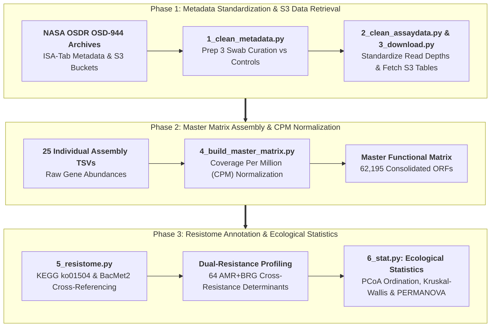

# Environmental Resistome and Homogenization of Extremotolerant Communities in Jet Propulsion Laboratory Cleanroom Environments

**Author(s):** Md Abu Sadat Soash  
*Department of Genetic Engineering and Biotechnology*<br>
*Shahjalal University of Science and Technology, Sylhet, Bangladesh*

[](https://osdr.nasa.gov/bio/repo/data/studies/OSD-944)
[](https://doi.org/10.26030/3zww-vy60)
[](https://www.python.org/)
[](https://creativecommons.org/publicdomain/zero/1.0/)

---

## Abstract

* **Objective:** NASA Jet Propulsion Laboratory (JPL) spacecraft assembly cleanrooms adhere to rigorous planetary protection standards to minimize forward microbial contamination of extraterrestrial targets. However, aggressive chemical disinfection and environmental stress inadvertently act as potent selective filters, fostering the survival of extremotolerant, multidrug-resistant (MDR) bacterial and fungal strains. This study maps the spatial distribution, ecological diversity, and cross-resistance potential of the environmental resistome across a Mars Exploration Program cleanroom facility.
* **Methodology:** We analyzed deep short-read metagenomic sequencing archives from NASA Open Science Data Repository study **OSD-944** (GLDS-775). Following removal of negative controls and standardization of low-biomass sequencing protocols ("Prep 3"), 25 assembled metagenomes were curated. Gene abundances across 62,195 open reading frames were normalized to Coverage Per Million (CPM). Functional resistome profiling was performed against the **KEGG** (`ko01504`) and **BacMet2** databases, coupled with non-parametric spatial hypothesis testing (Kruskal-Wallis) and beta diversity ordination (PERMANOVA).
* **Findings:** Environmental cleanroom swabs demonstrated a 100% assembly success rate, uncovering **447 verified environmental antibiotic resistance genes (ARGs)** spanning 13 microbial genera and **64 dual-resistance determinants** conferring simultaneous resistance to clinical antibiotics and industrial biocides/metals. Highest resistance burdens localized to human transition zones—specifically cabinet floors (1,211.6 CPM) and gowning rooms (1,066.5 CPM)—while flight hardware assembly surfaces maintained near-zero loads (43.8 CPM). Despite observational spatial gradients, statistical testing confirmed facility-wide ecological homogenization (Kruskal-Wallis $H = 8.5686, p = 0.285$; PERMANOVA pseudo-$F = 1.123, p = 0.321$). Extremotolerant reservoirs were overwhelmingly dominated by *Acinetobacter* (863.1 CPM), *Brevundimonas* (424.5 CPM), and *Paracoccus* (407.8 CPM).
* **Implications:** Cleanroom decontamination regimens act as an overarching selective filter that eliminates fragile commensals while homogenizing extremotolerant survivor populations across the entire facility footprint. The enrichment of multidrug efflux systems (*mexJK*) and dual-resistance regulators highlights the necessity of multi-mechanism biocidal rotation to safeguard planetary protection integrity.

---

## 1. Introduction & Biological Background

Planetary protection protocols are mandated by international treaty to prevent the forward biological contamination of celestial bodies (such as Mars and Europa) during interplanetary robotic missions. Spacecraft assembly occurs within specialized ISO-classified cleanroom environments subjected to continuous HEPA air filtration, laminar airflow, desiccation, UV irradiation, and strict chemical decontamination regimens.

```
                    Planetary Protection Cleanroom Protocols
                                       │
                 ┌─────────────────────┴─────────────────────┐
                 ▼                                           ▼
       Drastic Bioburden Reduction                 Extreme Selective Pressure:
     (Elimination of Fragile Taxa)               Desiccation, Biocides, UV, Starvation
                 │                                           │
                 └─────────────────────┬─────────────────────┘
                                       ▼
                     Emergence of Extremotolerant Cohorts:
                    • Acinetobacter, Brevundimonas, Paracoccus
                    • 64 Dual-Resistance Genes (AMR + BRG)
                                       │
                 ┌─────────────────────┴─────────────────────┐
                 ▼                                           ▼
      Human Transition Zone Hotspots               Facility-Wide Ecological
      (Cabinet Floors, Gowning Areas)             Homogenization (p = 0.321)
```

1. **The Sterilization Paradox:** Paradoxically, intense physical and chemical sterilization regimes eradicate vulnerable vegetative cells while selectively preserving spore-formers, radiation-resistant taxa, and strains encoding broad-spectrum multidrug efflux pumps.
2. **Dual Resistance and Cross-Tolerance:** Heavy exposure to quat-based disinfectants, hydrogen peroxide vapor, and isopropyl alcohol promotes the co-selection of Biocide/Metal Resistance Genes (BRGs) and clinical Antimicrobial Resistance Genes (ARGs) via common genetic cassettes and regulatory repressors (e.g., *tetR*/*acrR*, *merR*).
3. **Study Aims:** Using the NASA OSDR OSD-944 metagenomic dataset, this study systematically tracks the functional resistome burden across cleanroom architectural zones to assess whether spatial physical barriers or overarching facility-wide selective pressures dictate microbial survival.

---

## 2. Genomic Dataset & Cohort Stratification

From 38 raw sequencing runs in NASA OSDR OSD-944, 32 samples processed under the standardized "Prep 3" Illumina Nextera XT low-biomass protocol were curated:

| Sample Classification | Targeted Count | Assembled Successfully | Assembly Success Rate | Functional ORFs Called |
| :--- | :---: | :---: | :---: | :---: |
| **Environmental Cleanroom Swabs** | **18** | **18** | **100.0%** | **56,282** |
| **Reagent & Mock Controls** | 14 | 7 | 50.0% | 5,913 |
| **Total Analyzed Dataset** | **32** | **25** | **78.1%** | **62,195** |

Environmental swabs were categorized across eight defined cleanroom physical zones, contrasting high-traffic personnel transfer areas against critical spacecraft hardware assembly benches.

---

## 3. Computational Pipeline Architecture



---

## 4. Key Scientific Findings & Comparative Analysis

### 4.1 Master Functional Matrix & Assembly Success

Environmental cleanroom samples yielded a 100% assembly rate, confirming sufficient sequencing depth across low-biomass swabs to resolve 56,282 environmental open reading frames:

| Metric Dimension | Environmental Cleanroom Swabs | Reagent & Mock Controls | Consolidated Total |
| :--- | :---: | :---: | :---: |
| **Targeted Samples (Prep 3)** | 18 | 14 | 32 |
| **Successfully Assembled Metagenomes** | 18 | 7 | 25 |
| **Assembly Success Rate** | **100%** | 50.0% | **78.1%** |
| **Total Functional ORFs** | **56,282** | 5,913 | 62,195 |
| **Antimicrobial Resistance Genes (KEGG)** | **447** | 62 | 509 |
| **Dual-Resistance Determinants (AMR + BRG)** | **64** | 0 | **64** |

### 4.2 Cleanroom Resistome & Dual-Resistance Determinants

Cross-referencing functional genes against the KEGG Antimicrobial Resistance database (`ko01504`) and BacMet database revealed strong co-selection for chemical tolerance:
* **Bona Fide Environmental ARGs:** 447 verified ARGs mapped across 13 bacterial genera in cleanroom swabs.
* **Dual-Resistance Determinants:** **64 distinct genes** confer simultaneous resistance to clinical antibiotics and industrial biocides/metals. These cross-resistance determinants include *merR* family transcriptional regulators (`K19591`), *tetR*/*acrR* family repressors (`K18301`), and *mexJK* multidrug efflux systems. All 64 dual-resistance genes were localized exclusively within environmental samples.
* **Dominant Microbial Reservoirs:**
  * ***Acinetobacter* (863.1 CPM):** Primary driver of cleanroom resistance, mediated by streptothricin acetyltransferases and TetR/AcrR family efflux repressors.
  * ***Brevundimonas* (424.5 CPM):** Characterized by fluoroquinolone resistance proteins, BlaI family penicillinase repressors, and PhoQ sensor histidine kinases.
  * ***Paracoccus* (407.8 CPM):** Enriched in aminocyclitol acetyltransferases and multidrug efflux pumps.
  * ***Aspergillus* (20.1 CPM):** Eukaryotic fungal lineage encoding cross-protective efflux pumps.

### 4.3 Spatial Distribution & Facility Homogenization

```
                     ┌────────────────────────────────────────┐
                     │     Human Transition Zone Hotspots     │
                     │     ──────────────────────────────     │
                     │  • Cabinet floors: 1,211.6 CPM         │
                     │  • Gowning room floor: 1,066.5 CPM     │
                     │  • Airlock floor: 914.8 CPM            │
                     └────────────────────────────────────────┘

                     ┌────────────────────────────────────────┐
                     │      Critical Assembly Surfaces        │
                     │      ──────────────────────────        │
                     │  • Spacecraft surfaces: 43.8 CPM       │
                     │  • Tabletop surfaces: 7.4 CPM          │
                     │  • Direct physical barrier protection  │
                     └────────────────────────────────────────┘
```

* **Human Traffic as the Primary Vector:** The highest localized resistance burdens congregated in gowning rooms and transition corridors, reflecting personnel shedding and foot traffic. Critical spacecraft assembly benches remained near-zero.
* **Statistical Homogeneity Across Locations:**
  * **Kruskal-Wallis $H$-test:** $H = 8.5686, p = 0.285$ (no statistically significant difference in total AMR CPM across locations).
  * **PERMANOVA (Beta Diversity):** pseudo-$F = 1.123, p = 0.321$ (no significant divergence in microbial community composition across 8 cleanroom zones).
  * **Conclusion:** Severe chemical decontamination and continuous HVAC recirculation act as an overarching selective filter that homogenizes the resident extremotolerant community across the entire facility footprint.

---

## 5. Visual Highlights & Ecological Diversity

### 5.1 Ecological Diversity of the Resistome

| Alpha Diversity (Shannon Index Across Locations) | Beta Diversity (Principal Coordinate Analysis - True PCoA) |
| :---: | :---: |
|  |  |

### 5.2 Taxonomic & Spatial Resistance Burden

| Total AMR Load by Cleanroom Physical Location | Top 10 AMR-Carrying Bacterial Genera |
| :---: | :---: |
|  |  |

### 5.3 Resistance Mechanisms in Dominant Extremophiles

<p align="center">
  
</p>
<p align="center"><b>Figure: Resistance Mechanisms Driving the Dominant Extremophile *Acinetobacter*.</b> Frequency of functional annotations across streptothricin resistance, efflux pumps, and transcriptional repressors.</p>

---

## 6. Repository Organization

```text
spacecraft-resistome-dynamics/
├── run.py                                     # Master automated CLI pipeline orchestrator
├── 1_clean_metadata.py                        # Step 1: Metadata curation & sample classification
├── 2_clean_assaydata.py                       # Step 2: Sequencing metrics & read depths
├── 3_download_annotations.py                  # Step 3: Automated S3 download of OSDR tables
├── 4_build_master_matrix.py                   # Step 4: Consolidated CPM-normalized matrix
├── 5_resistome.py                             # Step 5: KEGG/BacMet resistome profiling
├── 6_stat.py                                  # Step 6: Ecological diversity & hypothesis testing
├── 1_clean_metadata.ipynb                     # Interactive Notebook 1
├── 2_clean_assaydata.ipynb                    # Interactive Notebook 2
├── 3_download_annotations.ipynb                # Interactive Notebook 3
├── 4_build_master_matrix.ipynb                # Interactive Notebook 4
├── 5_resistome.ipynb                          # Interactive Notebook 5
├── 6_stat.ipynb                               # Interactive Notebook 6
├── data/
│   ├── clean_metadata.tsv                     # Standardized sample metadata with Sample_Category
│   ├── clean_assaydata.tsv                    # Standardized sequencing quality & depth metrics
│   ├── master_functional_matrix.tsv           # CPM-normalized 62,195 functional gene matrix
│   ├── env_amr_df.tsv                         # Filtered cleanroom environmental resistome table
│   ├── summary_location_burden.tsv            # Total AMR burden (CPM) per cleanroom zone
│   ├── summary_genera_burden.tsv              # Total AMR burden (CPM) per microbial genus
│   ├── summary_acinetobacter_mechanisms.tsv   # Detailed functional breakdown for Acinetobacter
│   ├── total_amr_genes.tsv                    # List of identified AMR determinants
│   ├── total_dual_resistance_genes.tsv        # 64 dual-resistance genes (AMR + BRG)
│   ├── annotations/                           # Raw S3 gene-coverage & taxonomic TSVs
│   ├── database/                              # Cached reference databases (KEGG ko01504, BacMet2)
│   ├── figures/                               # High-resolution publication plots (300 DPI)
│   └── logs/                                  # Timestamped execution audit logs
├── nasa-osd944-resistome-analysis.docx         # Complete academic research manuscript draft
├── supplementary.txt                          # Study protocols, parameters, and metadata notes
└── README.md                                  # Comprehensive project documentation
```

---

## 7. Execution, Reproducibility & Environment Setup

### 7.1 Method A: One-Click Automated Pipeline (Recommended)
The master orchestrator (`run.py`) verifies dependencies, installs missing modules, and executes the complete workflow sequentially with automated logging:

```bash
# 1. Clone the repository
git clone https://github.com/Soash/spacecraft-resistome-dynamics.git
cd spacecraft-resistome-dynamics

# 2. Run the complete end-to-end pipeline (Python 3.10+)
python run.py
```

### 7.2 Method B: Interactive Jupyter Notebooks
```bash
# 1. Create and activate a virtual environment
python -m venv venv

# Windows (PowerShell):
.\venv\Scripts\Activate.ps1
# Linux / macOS:
source venv/bin/activate

# 2. Install dependencies
pip install pandas requests matplotlib seaborn scipy scikit-bio

# 3. Launch Jupyter
jupyter notebook
```

---

## 8. Authorship & Correspondence

If you utilize this workflow, curated matrices, or findings in your research, please cite:

> **Md Abu Sadat Soash** (2026). *Environmental Resistome and Homogenization of Extremotolerant Communities in Jet Propulsion Laboratory Cleanroom Environments.* Department of Genetic Engineering and Biotechnology, Shahjalal University of Science and Technology, Sylhet, Bangladesh.  
> GitHub: [https://github.com/Soash/spacecraft-resistome-dynamics](https://github.com/Soash/spacecraft-resistome-dynamics)

### Inquiries
- **Md Abu Sadat Soash** — Department of Genetic Engineering and Biotechnology, Shahjalal University of Science and Technology, Sylhet, Bangladesh
- **Email:** [mdabu13@student.sust.edu](mailto:mdabu13@student.sust.edu)

---

## 9. References & Data Availability

1. **Guan, L., Hinzer, A., Parker, C., & Cooper, M. (2026).** *JPL Mars Exploration Program Interlab Cleanroom Metagenomics*, NASA Open Science Data Repository, Version 1, [DOI: 10.26030/3zww-vy60](http://doi.org/10.26030/3zww-vy60).
2. **Kanehisa, M., Furumichi, M., Sato, Y., Kawashima, M., & Ishiguro-Watanabe, M. (2023).** KEGG for taxonomy-based analysis of pathways and genomes. *Nucleic Acids Research*, 51(D1), D587–D592.
3. **Pal, C., Bengtsson-Palme, J., Rensing, C., Kristiansson, E., & Larsson, D. G. J. (2014).** BacMet: antibacterial biocide and metal resistance genes database. *Nucleic Acids Research*, 42(D1), D737–D743.
4. **La Duc, M. T., et al. (2007).** Isolation and characterization of bacteria capable of tolerating the extreme conditions of clean room environments. *Applied and Environmental Microbiology*, 73(8), 2600–2611.
5. **The scikit-bio development team. (2020).** *scikit-bio: A bioinformatics library for Python*.
6. **Data License:** NASA Open Science Data Repository (OSDR) data is provided under the [Creative Commons CC0 1.0 Universal Public Domain Dedication](https://creativecommons.org/publicdomain/zero/1.0/).
